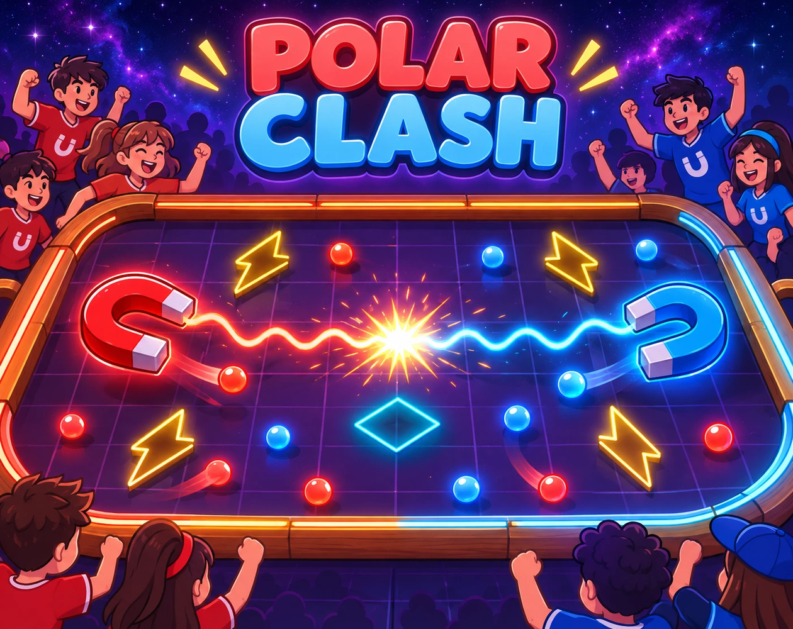
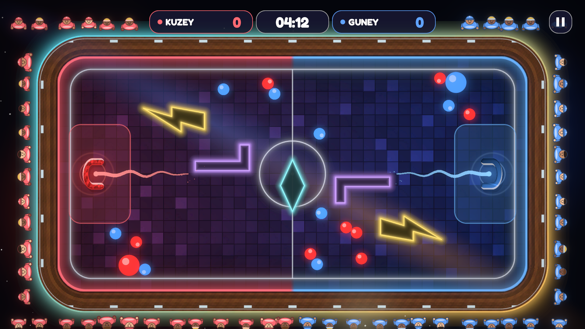
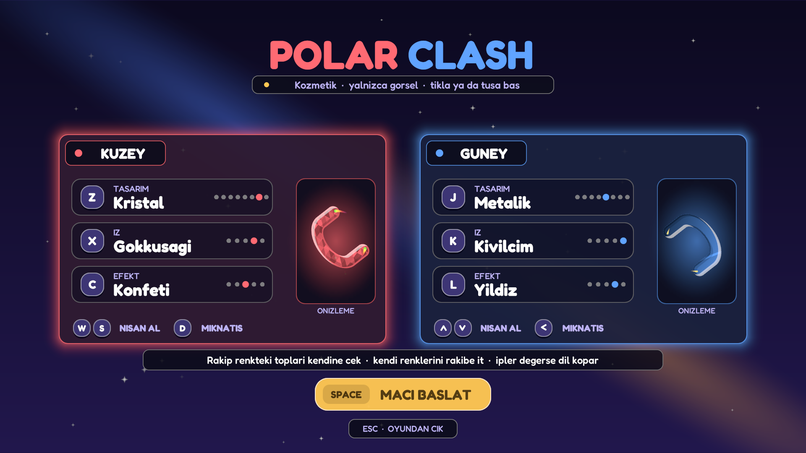
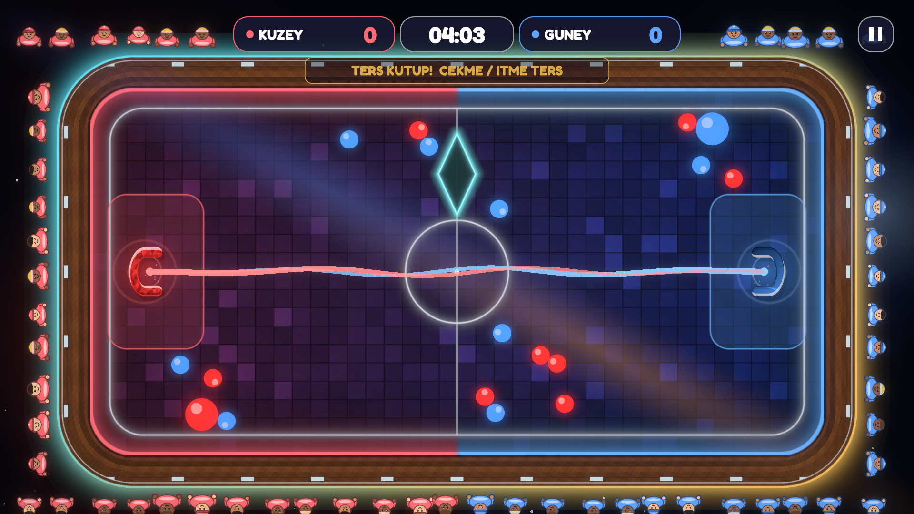

# Polar Clash

Aynı klavyede iki kişilik, neon temalı bir mıknatıs düellosu. Mıknatısını çevir, ipini fırlat; rakibin renkteki topları kendine çek, kendi renklerini rakibe doğru it. İpler birbirine değerse dilin kopar!

## Nasıl oynanır

- **KUZEY (kırmızı)** mavi topları toplar, **GÜNEY (mavi)** kırmızı topları.
- Mıknatısın ipi rakip renkteki topu **çeker**, kendi rengindeki topu **iter**.
- Top mıknatısa ulaşınca puan: küçük top **1**, büyük top **3** puan.
- Top çekerken rakibin ipi seninkine değerse dilin kopar ve 3 saniye ateş edemezsin.
- **Ters Kutup:** Arada bir çekme ve itme yer değiştirir. Ekrandaki uyarıyı takip et.
- Sahada yükselen tuzak duvarlar ve ortada gidip gelen hareketli bir duvar var.
- Maç 5 dakika sürer. Bir taraf hedef toplarının hepsini toplarsa maç erken biter.

## Kontroller

| | KUZEY | GÜNEY |
|---|---|---|
| Nişan al | W / S | ↑ / ↓ |
| Mıknatıs (ip) | D | ← |
| Kozmetik (menüde) | Z / X / C | J / K / L |

- **Space** maçı başlatır, **ESC** duraklatır, **R** yeniden başlatır, **Q** oyundan çıkar.
- Tüm menüler fareyle de kullanılabilir. Kozmetik satırına sol tıkla sonraki, sağ tıkla önceki seçenek gelir.

## Kozmetik

Yalnızca görsel, oynanışı etkilemez. Seçimler kaydedilir.

- **Tasarım:** Klasik, Gümüş uçlu, Çizgili, Neon kontur, Metalik, Noktalı, Kristal, Zikzak
- **İz:** Yok, Kısa, Uzun, Gökkuşağı, Kıvılcım
- **Efekt:** Patlama, Halka, Konfeti, Yıldız, Çift halka

## Geliştirme

- Unity **6000.3.26f1** (Unity 6), URP 2D, Input System
- Sahne: `Assets/Scenes/Arena.unity`
- Kodlar: `Assets/Scripts` (oyun mantığı, HUD ve efektler; çoğu görsel kodla üretilir)

## İndir

itch.io: **https://d3xs.itch.io/polar-clash** (Windows, ücretsiz)
